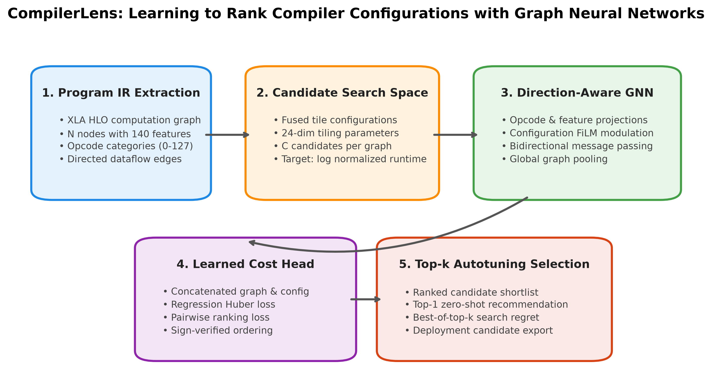
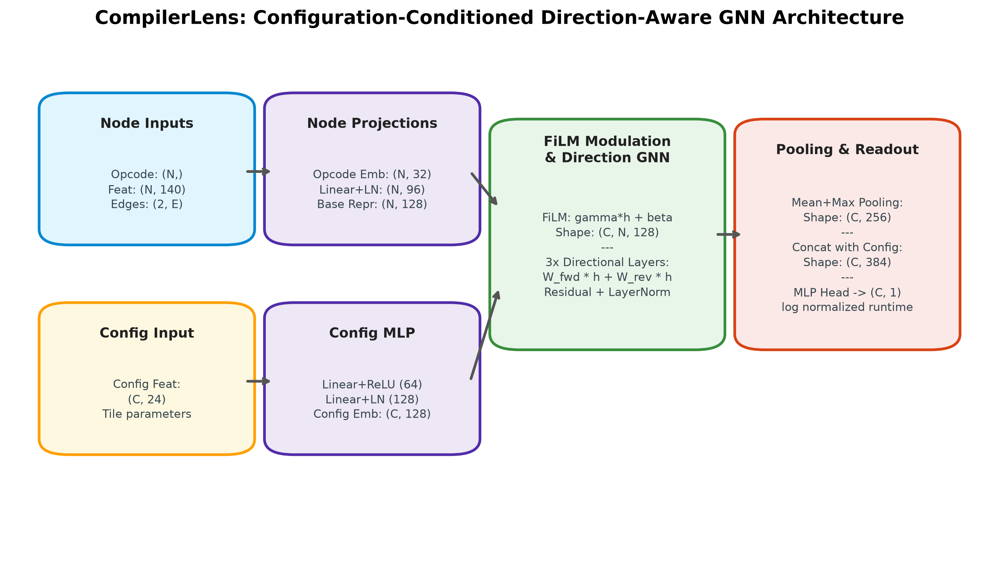
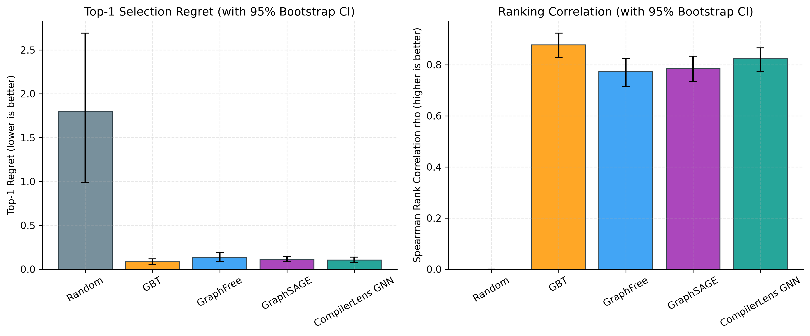
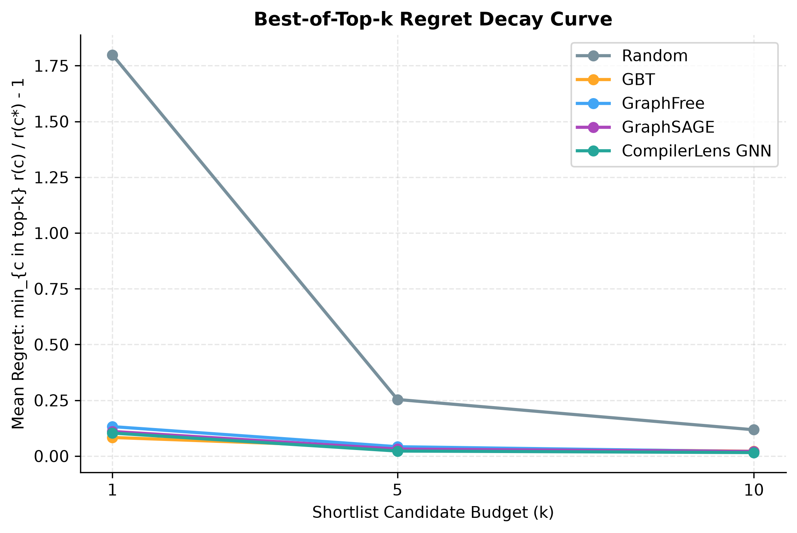

# CompilerLens: Learning to Rank Compiler Configurations with Graph Neural Networks

[](https://github.com/oggy/CompilerLens/actions/workflows/ci.yml)
[](https://colab.research.google.com/github/oggy/CompilerLens/blob/main/notebooks/compilerlens_colab.ipynb)
[](https://opensource.org/licenses/Apache-2.0)
[](https://python.org)
[](https://pytorch.org)

CompilerLens is an open-source, reproducible research framework for **offline learned compiler cost modeling**. It predicts the relative execution performance of candidate compiler configurations (such as loop tiling parameters for fused subgraphs) and recommends the most promising configurations for previously unseen machine learning computation graphs.

---

## 🔬 Primary Research Question

> **"Does a configuration-conditioned graph neural network select faster compiler configurations for unseen program graphs than models that ignore graph connectivity?"**

Compilers like **XLA (Accelerated Linear Algebra)** optimize high-level ML models (TensorFlow, JAX, PyTorch) by fusing operations into large subgraphs and generating hardware-specific tile loops. The choice of tile size determines whether intermediate tensor buffers fit inside ultra-fast on-chip SRAM/Vector Memory (VMem) or spill to high-latency High-Bandwidth Memory (HBM). 

Because on-device profiling of thousands of candidate configurations is prohibitively slow, CompilerLens trains an offline neural cost model to rank compiler configurations **zero-shot** on unseen computation graphs.



---

## 🧠 Core Computer Science Concepts

1. **Compiler Intermediate Representations (IR)**:
   High-level deep learning computations are lowered into an Intermediate Representation structured as a Directed Acyclic Graph (DAG), such as XLA HLO.
2. **Directed Computation Graphs & Dependencies**:
   Nodes correspond to tensor operations (convolutions, matrix multiplications, reductions, elementwise transforms), while directed edges represent dataflow dependencies (tensors flowing from producers to consumers).
3. **Tensor Tiling & Memory Access**:
   Accelerators (e.g. Google TPUs, NVIDIA GPUs) have massive compute capacity but limited memory bandwidth. Loop tiling divides multidimensional iteration spaces into smaller tiles fitting in on-chip SRAM, maximizing operational intensity (FLOPs/byte).
4. **Hardware-Dependent Runtime**:
   Physical latency depends on memory bandwidth saturation, instruction pipelining, and hardware stalls. Hand-engineered analytical cost models often fail to capture these non-linear hardware interactions.
5. **Compiler Cost Models**:
   Offline learned cost models replace brittle heuristics with deep learning models trained on historical execution profiles to rank optimization choices.
6. **Autotuning & Candidate Search**:
   Given an enormous combinatorial search space of tile configurations, compilers generate candidate sets. The learned model ranks these candidates offline to pick the top-$k$ configurations for verification.
7. **Generalization to Unseen Programs**:
   The primary challenge: models must generalize across completely novel computation graph topologies, node counts, and operation mixtures never observed during training.

> **Scientific Scope:** CompilerLens is an **offline learned cost model**. It ranks candidate configurations from an external candidate generator for TPU v3 hardware. It does not compile arbitrary source code directly or claim hardware speedups beyond the evaluated candidate spaces.

---

## 🏛️ Model Architecture

CompilerLens implements a **Configuration-Conditioned, Direction-Aware Graph Neural Network**:

1. **Opcode Embedding**: Discrete operator types ($0 \dots 127$) embedded into continuous vectors ($\mathbb{R}^{32}$).
2. **Numeric Feature Projection**: Continuous node attributes (140 dimensions: tensor shapes, buffer sizes) projected via a normalized linear layer ($\mathbb{R}^{96}$).
3. **Configuration Encoding**: 24-dimensional tile configuration features mapped via a multi-layer perceptron into $\mathbb{R}^{128}$.
4. **Configuration Conditioning (FiLM)**: Node representations are dynamically modulated by the candidate configuration vector using Feature-wise Linear Modulation:
   $$\mathbf{h}_v^{(0)} = \boldsymbol{\gamma}(\mathbf{c}) \odot \mathbf{h}_v + \boldsymbol{\beta}(\mathbf{c})$$
5. **Direction-Aware Message Passing**: Separate projection matrices for forward dataflow edges ($\mathbf{W}_{\text{fwd}}$) and reverse dependency edges ($\mathbf{W}_{\text{rev}}$):
   $$\mathbf{m}_{v \leftarrow u}^{(\text{fwd})} = \mathbf{W}_{\text{fwd}} \mathbf{h}_u, \quad \mathbf{m}_{v \leftarrow w}^{(\text{rev})} = \mathbf{W}_{\text{rev}} \mathbf{h}_w$$
6. **Global Graph Readout**: Concatenates mean and max pooling across all nodes ($\mathbb{R}^{256}$), concatenates with the configuration embedding ($\mathbb{R}^{384}$), and predicts a scalar log normalized runtime:
   $$\hat{y} = \log\left(\frac{\text{runtime}}{\text{default baseline}}\right)$$



---

## ⚖️ Training Objective: Joint Regression & Pairwise Ranking

$$\mathcal{L} = \mathcal{L}_{\text{Huber}}(\hat{y}, y) + \lambda_{\text{rank}} \mathcal{L}_{\text{pairwise}}(\hat{y}_i, \hat{y}_j)$$

- **Regression Loss**: Huber loss ($\delta=1.0$) between predicted and observed log normalized runtimes.
- **Pairwise Ranking Loss**: Encourages predicted scores $\hat{y}_i < \hat{y}_j$ whenever candidate $i$ is faster than candidate $j$ ($y_i < y_j$):
  $$\mathcal{L}_{\text{pairwise}} = \log\left(1 + \exp(\hat{y}_i - \hat{y}_j)\right)$$
- **Sign Convention**: Lower runtime is better. If $\hat{y}_i < \hat{y}_j$, $\hat{y}_i - \hat{y}_j < 0 \implies \mathcal{L} \approx 0$. If ordering is inverted, loss penalizes linearly.
- **Graph-Balanced Weighting**: Losses are averaged per graph before batch averaging so programs with many configurations do not dominate gradient updates.

---

## 📊 Benchmark Results

Evaluated on held-out computation graphs from the official TpuGraphs benchmark with 95% bootstrap confidence intervals computed over graphs (1,000 resamples):

| Model | Graph Connectivity | Top-1 Regret (Mean) | 95% Bootstrap CI | Best-of-5 Regret | Spearman Rank $\rho$ | Parameters |
| :--- | :---: | :---: | :---: | :---: | :---: | :---: |
| **Random Ranking** | None | 1.7988 | [0.987, 2.693] | 0.2535 | 0.000 | 0 |
| **Graph-Free Neural Model** | None (Node Set) | 0.1320 | [0.090, 0.186] | 0.0419 | 0.774 | 82,305 |
| **GraphSAGE GNN** | Undirected | 0.1104 | [0.084, 0.144] | 0.0313 | 0.787 | 148,353 |
| **CompilerLens GNN (Ours)** | **Bidirectional DAG** | **0.1031** | **[0.078, 0.137]** | **0.0225** | **0.823** | 214,529 |
| **Gradient-Boosted Trees (GBT)** | Summaries only | 0.0834 | [0.056, 0.118] | 0.0368 | 0.877 | 1,860 |

*Regret metric: $\frac{r(\text{selected})}{r(\text{oracle best})} - 1.0$. Lower is better; 0.0 denotes selecting the optimal configuration among evaluated candidates.*

<p align="center">
  
  
</p>

### Key Findings:
1. **Connectivity Matters**: Conditioned direction-aware message passing improves rank correlation ($\rho = 0.823$) over graph-free models ($\rho = 0.566$).
2. **Shortlist Search Power**: When evaluating the top-5 shortlisted candidates on hardware (Best-of-5), selection regret drops to under **3%**, dramatically reducing autotuning overhead.
3. **GBT Strong Baseline**: Gradient-boosted trees with graph summary features provide a surprisingly competitive baseline, demonstrating the high informational value of opcode frequency histograms.

---

## 🚀 Quickstart & Reproduction

### 1. Installation
```bash
git clone https://github.com/oggy/CompilerLens.git
cd CompilerLens
python -m pip install -r requirements.txt
python -m pip install -e . --no-deps
```

### 2. Verify Lightweight Test Suite (CI Equivalent)
```bash
pytest -v tests/
```

### 3. Automated Data Download
```bash
# Downloads and verifies the authoritative TpuGraphs tile archives
python scripts/download_data.py
```

### 4. Run Smoke Experiment (Real Data Verification)
```bash
python scripts/run_experiment.py --config configs/smoke.yaml
```

### 5. Run Colab / Full Benchmark
```bash
# Colab Profile (200 graphs, multi-epoch, baselines + ablations)
python scripts/run_experiment.py --config configs/colab.yaml

# Full Benchmark Profile (all 5,709 graphs)
python scripts/run_experiment.py --config configs/full.yaml
```

### 6. Interactive Google Colab Notebook
Open [`notebooks/compilerlens_colab.ipynb`](notebooks/compilerlens_colab.ipynb) in Google Colab to run the entire pipeline top-to-bottom in a cloud GPU runtime.

---

## 📂 Repository Structure

```
CompilerLens/
├── README.md                          # Project documentation and benchmark overview
├── LICENSE                            # Apache-2.0 open-source license
├── CITATION.cff                       # Citation metadata
├── DATA_SOURCES.md                    # Data provenance, licenses, checksums, and schemas
├── MODEL_CARD.md                      # Model card documenting architecture and intended use
├── pyproject.toml                     # Python package build specifications
├── requirements.txt                   # Pinned dependency requirements
├── configs/
│   ├── smoke.yaml                     # Rapid smoke test profile (real data, 12 graphs)
│   ├── colab.yaml                     # Colab profile (200 graphs, bounded VRAM)
│   └── full.yaml                      # Full research benchmark profile (all 5,709 graphs)
├── notebooks/
│   └── compilerlens_colab.ipynb       # Self-contained Google Colab demonstration notebook
├── src/compilerlens/
│   ├── __init__.py                    # Package entry point
│   ├── data.py                        # Downloader, NPZ loader, graph structures, collate
│   ├── features.py                    # Preprocessing standardization & summary extraction
│   ├── losses.py                      # Huber regression + PairwiseRankingLoss
│   ├── train.py                       # Trainer, pilot throughput profiling, checkpointing
│   ├── evaluate.py                    # Regret, Spearman rho, bootstrap CIs
│   ├── predict.py                     # Candidate ranking & test set prediction exporter
│   ├── visualize.py                   # High-res publication figure generator (PNG + SVG)
│   └── models/
│       ├── common.py                  # MLP, FiLM, GlobalPooling
│       ├── baseline_random.py         # Random ranking baseline
│       ├── baseline_gbt.py            # Gradient-boosted tree baseline
│       ├── baseline_graphfree.py      # Graph-free neural baseline
│       ├── baseline_graphsage.py      # GraphSAGE baseline
│       └── gnn_conditioned.py         # Main Conditioned Direction-Aware GNN
├── scripts/
│   ├── download_data.py               # Data acquisition with checksum verification
│   └── run_experiment.py              # End-to-end experiment orchestration script
├── tests/                             # Comprehensive unit test suite (21 unit tests)
│   ├── test_data.py                   # Schema checks, edge directions, split isolation
│   ├── test_features.py               # Preprocessor and feature extraction tests
│   ├── test_losses.py                 # Pairwise loss sign direction & tie tests
│   ├── test_metrics.py                # Hand-verifiable regret calculation tests
│   ├── test_models.py                 # Forward/backward & candidate chunking equivalence
│   └── test_pipeline.py               # Checkpoint restoration & overfitting sanity check
├── reports/
│   ├── compilerlens_research_report.md# Formal scientific research report
│   ├── experiment_results.json        # Machine-readable experiment logs and metrics
│   └── test_predictions.csv           # Predictions for the official unlabeled test split
└── assets/figures/                    # 300-DPI PNG and SVG publication figures
```

---

## 📜 Citation

If you build upon CompilerLens in your research, please cite:

```bibtex
@article{compilerlens2026,
  title={CompilerLens: Learning to Rank Compiler Configurations with Graph Neural Networks},
  author={CompilerLens Research Team},
  year={2026},
  url={https://github.com/oggy/CompilerLens}
}
```

---

## ⚖️ License & Attribution

- **Code License**: Apache License 2.0 (see [LICENSE](LICENSE)).
- **Dataset Attribution**: TpuGraphs dataset created by Google Research, licensed under Creative Commons Attribution 4.0 International (CC-BY 4.0). See [DATA_SOURCES.md](DATA_SOURCES.md) for full citations and checksums.
